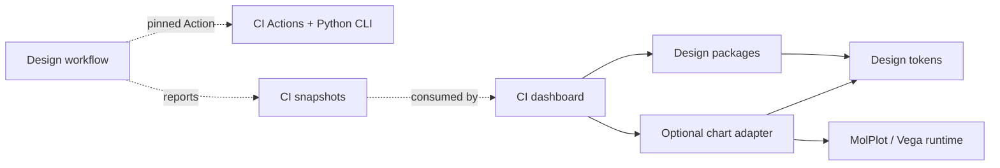

# molcrafts-ci dashboard: assessment of the first real consumer

Date: 2026-10-10 · Status: historical assessment snapshot. The user later authorized charts and the product migration. The current decision is in [chart architecture](chart-architecture.md). Nothing has been published yet.

Assessment snapshot:

- Design: `d2306e8617e5b1b4533be3f87aae8c872fa546ed`, three private 0.0.1 packages.
- CI: [d9589edea17d1ebda330bafd271030a5f4c0a565](https://github.com/MolCrafts/molcrafts-ci/tree/d9589edea17d1ebda330bafd271030a5f4c0a565), default branch master.
- MolPlot: [336d301047fa748837a105f876ce6889cc4b92ae](https://github.com/MolCrafts/molplot/tree/336d301047fa748837a105f876ce6889cc4b92ae), core 0.1.7.

## Conclusion

It is a good first real downstream pilot. The goal is for Design to provide the dashboard's shared controls, common presentation patterns, and chart container,
while business assembly stays in CI. A full visual replacement cannot be finished directly today: the basic controls have usable
public entries, but common blocks and the chart interface still have gaps, and the old product tokens, fonts, and icons have not been migrated.

Repositories using each other is not the same as an npm or Python runtime cycle. It is a reasonable split of responsibility for the dashboard to consume the UI packages and for the
UI workflow to consume CI's Actions and CLI. The CLI and Actions must stay independent of the site,
and the required checks or release processes of the two repositories must not wait on each other for "the latest version".

## What was actually verified, and the limits

In a temporary copy of the site outside the repository:

1. All 9 vendored primitives were deleted, and 21 imports were rewritten to `@molcrafts/design`.
2. The local Design and tokens tarballs were installed with npm. An npm override pointed the internal tokens dependency
   at the same local tarball, so the trial did not require an npm version that has not been published. The original CI checkout was not modified.
3. TypeScript passed. All 6 existing test files and all 68 tests passed.
4. `@molcrafts/design/styles.css` was imported, and a direct Rsbuild build passed.
   The old `sync-ui` command was bypassed because the trial had already deleted the copy source. The original repository's build scripts were not modified.

The environment was Node 24. That shows an npm consumer can take a package produced by pnpm and Rslib, and that the dashboard does not have to
switch package managers in order to consume Design. It does not prove that an existing Node 22 deployment environment is identical in every way.

The original tests mostly cover data, URLs, and plugin logic. A full browser, visual, and accessibility
acceptance pass of the migrated pages has not been done. The trial kept the old product CSS and business components. It has not verified a complete Fluent theme, and it has not replaced the existing charts.
The Rsbuild output already has an async chart chunk of about 284.9 KB gzip (that trial build, not a delta between versions),
which means the chart runtime should keep loading on demand. This evidence is not the same as a merged real-product PR or a finished P5.

## Component coverage and ownership

CI currently has 9 primitives, 17 top-level component modules, 3 layout modules, and 1 section block.
A module count is not a component count. For example, meta-strip exports both MetaStrip and MeasureBand.

| Current dashboard parts | Assessment | Target ownership |
| --- | --- | --- |
| Button / Tabs / Table / ScrollArea / EmptyState / Separator / Tooltip / Resizable / ContextMenu | 9/9 have canonical exports. The temporary types and the existing tests passed. Visual appearance and states still need acceptance. | Consume @molcrafts/design directly and delete the copied implementations |
| ContentSection | A generic semantic section. It can be extracted. There is no matching complete contract today. | A Design block, with title, description, actions, and body slots |
| MetaStrip / MetricTable / MeasureBand | Can be abstracted as description and property lists, a metric group, and a measure bar | Design owns the presentation. CI passes already formatted values, units, and percentages |
| StatusMark / StatusInline | Generic status indication and distribution display. They can be abstracted, and a status token family already exists. | Design owns style and accessibility. CI maps business verdicts and counts |
| BandSkeleton / RowsSkeleton | Use the existing Skeleton to add purposeful variants and compositions | A Design loading pattern. Do not import CI payload types |
| WorkbenchShell / WorkSurface / LeftExplorer | Product-agnostic slots, resize, and layout can be reused, but the current package does not provide them completely | Design provides the generic frame. CI keeps navigation, tabs, dock content, and the storage key |
| ProjectList | A generic navigation row and list can be shared | Project-list data, sorting, and URL state stay in CI |
| ProfileSelect / HistorySelect | Can be presented by a unified NativeSelect or Select. Keep the mobile native-picker requirement. | Design owns the control. CI keeps profile grouping, the limit of 10, and option formatting |
| ThemeToggle | Button, the Fluent icon, and ThemeScope can be shared | CI keeps the user preference and the molci.theme storage key |
| TrendChart | Currently uses molplot-chart plus a Vega-Lite spec, and needs a chart wrapper | Design owns the chart container, lifecycle, and theme. CI keeps the HistoryPoint to data and spec mapping |
| RecordTrends / RecordTable / CoverageFileTable | Composed from shared chart, table, status, and metric patterns | CI keeps record identity, delta decisions, and coverage thresholds, sorting, and truncation |
| OperationsDock / PayloadView / CommitLink / RunLink | Clearly depend on a CI snapshot, a GitHub run or commit, or domain readers | Stay CI business components, assembled with shared UI |
| plugins / URL state / data fetching / snapshot schemas | Application capabilities. They do not belong in a component library. | Always stay in CI. Do not pull them back into Design |

"Every component can be supported by Design" is a reasonable goal. Having the library export CoverageFileTable or
PayloadView directly, and depend on a CI schema, would break product independence. Generic blocks can stay in packages/ui.
Do not split out a new package just for a new component category. Use the existing Table first. Do not
introduce a heavy DataGrid or virtualization framework early for pages that have only a few records.

## Migration work that is already confirmed

- The [old sync script](https://github.com/MolCrafts/molcrafts-ci/blob/d9589edea17d1ebda330bafd271030a5f4c0a565/site/scripts/sync-ui.mjs)
  reads the sibling molcrafts-ui/src path, while Design has moved into packages and removed source copying. When the old checkout
  is absent, vendored files are still used. When it is present, the script can fail because the old path does not exist. The product PR should delete
  sync-ui and the vendored implementations directly and change the build and dev scripts. Do not add a compatibility branch.
- Delete the copied shared theme and constitution files and the obsolete accent and mc aliases. Move to compiled CSS
  and complete, separately reviewed light and dark primary and secondary families. The product can still use Tailwind for its own layout.
- [Product styles](https://github.com/MolCrafts/molcrafts-ci/blob/d9589edea17d1ebda330bafd271030a5f4c0a565/site/src/styles/tailwind.css)
  override the Geist and JetBrains fonts and keep the old token rules. Unify on Fluent fonts and geometry and on official Fluent
  icons, and replace Lucide. Importing a stylesheet is not, by itself, a claim that the visual style is unified.
- The current product patches the internal `display:table` of Radix ScrollArea, and a horizontal overflow of 16,232px has been recorded.
  Design's ScrollArea does not yet have a matching generic fix. That real regression needs to be covered by a component test and then fixed.
  Do not simply delete the product workaround, and do not turn a long-term contract into CSS that overrides internal DOM.
- The Profile and History pickers deliberately used a native select. First unify the NativeSelect style and contract.
  Do not assume that switching to Radix Select keeps the mobile experience.
- Check resizable persistence, dock collapse, opening a table from the keyboard, URL deep links, and accessible names for icon-only controls.
  Do not keep an old public API shim. Migrate the call sites directly, and verify the meaning of the data and the actions at the same time.

## Vega and MolPlot

The existing [TrendChart](https://github.com/MolCrafts/molcrafts-ci/blob/d9589edea17d1ebda330bafd271030a5f4c0a565/site/src/components/trend-chart.tsx)
uses molplot-chart from `@molcrafts/molplot` 0.1.7. The spec is Vega-Lite line and point layers,
with a tooltip, emphasis on failed points, a height of 72px, and a responsive width. The site also declares Vega, Vega-Lite, and
vega-embed directly. Whether those direct dependencies are still needed should be checked during the migration. Do not install two renderers.

MolPlot already has lazy vega-embed, a ResizeObserver, serialization of async renders, ready and error states, and
view.finalize and dispose. Those should be reused first. It also has its own scientific plotting product contract:

- RawChart accepts a Vega-Lite spec. That does not promise support for an arbitrary raw Vega spec.
- The default is a scientific serif and paper preset. RawChart strips some numeric font sizes from the author's configuration.
- Auto theme only watches html.class. The current CI TrendChart also reads documentElement tokens.
  Neither automatically satisfies ThemeScope's nested themes or runtime brand updates.
- The current basic render path is fixed to canvas. If a generic VegaChart promises a choice of SVG or canvas, that API still has to be added.

Define Design's own VegaLiteChart and Sparkline contract first, using the current trend chart as the first example.
Prefer reusing MolPlot's public capabilities, and evaluate adding injectable theme, renderer, and scope APIs. In the first round,
do not treat MolPlot's paper preset as a Fluent preset, and do not copy MolPlot source into the UI.
If that scientific product contract does not fit a generic UI, using vega-embed as the adapter underneath is also reasonable. Record
that boundary, and avoid nesting two real renderers at once. Support for a full Vega spec is declared and verified separately.

A chart contract includes at least spec and data, size and responsive behavior, loading, error, and empty states, theme and product
palette, events, renderer, unmount cleanup, disposal of stale async results, an accessible
summary or fallback, and extension slots. The React and native implementations share tokens and render-adapter capability.
Do not stuff the React component package into a Web Component, and do not claim native parity without implementing it.

Axes, legends, and UI labels use Fluent tokens. Scientific-data categorical, sequential, and diverging
palettes are provided explicitly by the product. Do not map every data series to primary or secondary.
Failed points and business-unit or commit tooltips are built by CI as data or as a spec. The library does not import HistoryPoint.
The current aria-hidden sparkline also needs review: if it carries information that exists nowhere else, provide a text summary or a readable data alternative.

The Vega runtime is not required for consumers of the basic controls. An optional chart distribution boundary is recommended (the package name is not decided yet). It would depend on
shared tokens, the UI it needs, and a plotting engine. The basic tokens and UI packages do not depend back on it. That boundary has a real
runtime and download-size reason, and a reason to load independently. It is not an arbitrary split by component category. Verify this use case first, then decide whether to
add a separate package or use a charts subpath that is not exported from the root barrel, plus optional peers. Do not change
the existing three-package first-release plan ahead of that.

## Layered dependencies and the CI loop

The wheel in [CI pyproject](https://github.com/MolCrafts/molcrafts-ci/blob/d9589edea17d1ebda330bafd271030a5f4c0a565/pyproject.toml)
contains only src/molcrafts_ci and src/molci. It does not contain the site or the UI npm packages.
Actions report and submit install the Python CLI. They do not need to build the dashboard.
Design's current workflow uses direct Node, pnpm, and Playwright steps. It has not adopted molcrafts-ci Actions yet.
The diagram above is the architecture the user has in mind as a next step. It is not a claim that a two-way workflow dependency already exists.

A healthy dependency direction: the dashboard build depends on an explicit UI version; the Design workflow depends only on
a pinned CI Action or CLI version, or a full SHA; core validation of the UI does not wait for a dashboard deploy,
and it does not call CI's whole workflow (that whole workflow includes the site and tests in other languages and for partners).
Reporting data and displaying it can form a feedback loop, but that is not a release cycle in which each side is a build precondition of the other.

What is actually unreasonable:

- A UI package imports the CI site or schema, creating a cross-product runtime or source cycle.
- UI required checks wait for a CI release, and the CI release waits for this UI release that has not happened yet.
- Either side consumes the other's unverified latest or master by default, so builds are not reproducible or the workflows trigger each other.
- Installing the CLI or Action triggers a front-end npm build, so an engineering tool that was independent now needs the UI.

The [shared setup-node](https://github.com/MolCrafts/molcrafts-ci/blob/d9589edea17d1ebda330bafd271030a5f4c0a565/actions/setup-node/action.yml)
currently defaults to Node 22 and installs only npm. Design needs Node 24 and pnpm 11.25.0. For now, adopt only context,
report, and submit, and keep Design's toolchain setup. Or open a separate action PR in the CI repo that supports packageManager.
Do not run npm install against the pnpm workspace just to share one CI setup.

## Suggested order for the first consumer

1. Design: first fill in the generic contracts and stories above, handle the ScrollArea regression, and settle the chart-engine
   adapter and one complete Vega-Lite trend-chart example. The focus is shared presentation, not manufacturing the entire dashboard API at once.
2. Design CI: use the site at a pinned CI commit as an integration fixture, inject the tarball built by the current PR,
   then run typecheck, data tests, and browser checks. Run only the consumer targets that are needed.
   Do not recursively run the entire CI of both repositories.
3. The CI product PR: delete source sync and the vendored UI, and switch to public imports and compiled CSS.
   Finish the product brand, icons, generic blocks, and the graph-adapter integration. While the packages are private, use a pinned tarball
   for candidate verification first. A real deploy needs a durable pinned version artifact. It cannot depend on CI artifacts that expire in seven days.
4. The Design workflow: separately adopt report and submit pinned by SHA, and produce a test report that is actually usable.
   Do not invent a coverage number when there is no coverage artifact. Keep report and telemetry separate from the unit, type, and package gates.
5. Product browser acceptance: projects, overview, record, history, profile, coverage, the dock, deep links, and network failure;
   light and dark modes and product colors; sidebar resize and collapse, and chart resize and data updates; keyboard, accessibility, and visual checks, and chart unmount.

This assessment did not modify CI or MolPlot source and did not open a downstream PR. It only changed a disposable copy of the site.
A full replacement and workflow integration need real evidence in later implementation. These 68 data tests do not stand in for that.
