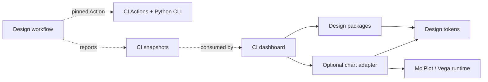

# molcrafts-ci dashboard：首个真实消费者评估

日期：2026-10-10 · 状态：历史评估快照；随后用户已授权图表与产品迁移。当前决策见 [chart architecture](chart-architecture.md)，仍未发布。

评估快照：

- Design：`d2306e8617e5b1b4533be3f87aae8c872fa546ed`，三个 private 0.0.1 包。
- CI：[d9589edea17d1ebda330bafd271030a5f4c0a565](https://github.com/MolCrafts/molcrafts-ci/tree/d9589edea17d1ebda330bafd271030a5f4c0a565)，默认分支 master。
- MolPlot：[336d301047fa748837a105f876ce6889cc4b92ae](https://github.com/MolCrafts/molplot/tree/336d301047fa748837a105f876ce6889cc4b92ae)，core 0.1.7。

## 结论

适合作为首个真实下游试点。目标是 dashboard 的共享控件、通用呈现模式与图表容器
由 Design 提供，业务组装仍在 CI。当前不能直接完成全部视觉替换：基础控件有可用
公开入口，通用 blocks 与图表接口尚有缺口，旧产品 tokens/字体/图标也未迁移。

repository 层面相互使用不等于 npm/Python 运行时循环。Dashboard 消费 UI 包、
UI workflow 消费 CI 的 Actions/CLI 是合理的职责划分；必须让 CLI/Actions 独立于 site，
并避免两个仓库的 required checks 或发布流程相互等待“最新版本”。

## 实际验证与限度

在仓库外的临时 site 副本中：

1. 删除全部 9 个 vendored primitives，重写 21 处 import 为 `@molcrafts/design`。
2. 使用 npm 安装 Design 与 tokens 的本地 tarball；内部 tokens 通过 npm override
   指向同一个本地 tarball，避免要求尚未发布的 npm 版本。原始 CI checkout 未修改。
3. TypeScript 通过；原有 6 个测试文件、68 项测试全部通过。
4. 引入 `@molcrafts/design/styles.css`，直接调用 Rsbuild 构建通过。
   绕过旧 `sync-ui` 命令，因为试验已经删除复制来源；没有修改原仓库构建脚本。

环境为 Node 24；这证明 npm 消费方可接入 pnpm/Rslib 生产的包，dashboard 无需为了
消费 Design 强制更换包管理器。它不能证明现有 Node 22 的部署环境全部无差异。

原测试主要覆盖数据、URL 与插件逻辑；尚未做迁移页面的完整浏览器、视觉、a11y
验收。试验保留旧产品 CSS 与业务组件，尚未验证完整 Fluent 主题，也未替换现有图表。
Rsbuild 产物中已有异步图表 chunk，约 284.9 KB gzip（该试验构建，不是版本间增量），
说明图表 runtime 应继续按需加载。以上证据不等于真实产品 PR 已合并或 P5 完成。

## 组件覆盖与所有权

CI 当前有 9 个 primitives、17 个顶层组件模块、3 个 layout 模块和 1 个 section block。
模块数量不等于组件数量；例如 meta-strip 同时导出 MetaStrip 和 MeasureBand。

| Current dashboard parts | Assessment | Target ownership |
| --- | --- | --- |
| Button / Tabs / Table / ScrollArea / EmptyState / Separator / Tooltip / Resizable / ContextMenu | 9/9 有 canonical exports；临时类型与既有测试通过；视觉/状态需验收 | 直接消费 @molcrafts/design，删除复制实现 |
| ContentSection | 通用语义 section，可提取，当前无对应完整 contract | Design block，标题/说明/actions/body slots |
| MetaStrip / MetricTable / MeasureBand | 可抽象为 description/property lists、metric group 与 measure bar | Design 拥有呈现；CI 传已格式化值/单位/百分比 |
| StatusMark / StatusInline | 通用状态指示与分布展示，可抽象，已有状态 token 族 | Design 拥有样式/a11y；CI 映射业务 verdict 与数量 |
| BandSkeleton / RowsSkeleton | 用已有 Skeleton 补 purposeful variants/compositions | Design loading pattern，不导入 CI payload 类型 |
| WorkbenchShell / WorkSurface / LeftExplorer | 产品无关的 slots/resize/layout 可复用，但当前包不完整提供 | Design 提供通用框架；CI 保留导航、tab、dock 内容与 storage key |
| ProjectList | 通用 navigation row/list 可以共享 | 项目列表数据、排序与 URL state 在 CI |
| ProfileSelect / HistorySelect | 可由统一 NativeSelect/Select 呈现；保留移动端原生 picker 需求 | Design 控件；CI 保留 profile 分组、10 条限制、选项格式化 |
| ThemeToggle | Button/Fluent icon/ThemeScope 可共享 | CI 保留用户偏好与 molci.theme storage key |
| TrendChart | 现用 molplot-chart + Vega-Lite spec，需要图表封装 | Design 图表容器/生命周期/主题；CI 保留 HistoryPoint→data/spec 映射 |
| RecordTrends / RecordTable / CoverageFileTable | 由共享图表、表格、状态和指标模式组成 | CI 保留 record identity、delta 判断、coverage 阈值/排序/截断 |
| OperationsDock / PayloadView / CommitLink / RunLink | 明确依赖 CI snapshot、GitHub run/commit 或 domain readers | 继续作为 CI 业务组件，用共享 UI 组装 |
| plugins / URL state / data fetching / snapshot schemas | 应用能力，不属于组件库 | 始终在 CI，不反向引入 Design |

“所有组件可由 Design 支撑”是合理目标；让库直接导出 CoverageFileTable 或
PayloadView 并依赖 CI schema，会违反产品独立性。通用 blocks 可以仍放 packages/ui，
不为一个新组件类别单独拆包。表格先使用现有 Table，不为只有少量记录的页面
提前引入重量级 DataGrid/virtualization 框架。

## 已确认的迁移工作

- [旧 sync 脚本](https://github.com/MolCrafts/molcrafts-ci/blob/d9589edea17d1ebda330bafd271030a5f4c0a565/site/scripts/sync-ui.mjs)
  读取 sibling molcrafts-ui/src，而 Design 已搬入 packages 并移除源复制。旧 checkout
  不在时继续用 vendored 文件；在时可能因旧路径不存在而失败。产品 PR 应直接删除
  sync-ui 与 vendored 实现，修改 build/dev scripts，不增加兼容分支。
- 删除复制来的共享 theme/constitution 文件与过时 accent/mc aliases；迁移到编译 CSS
  和完整、分别审查的明暗 primary/secondary 家族。产品仍可使用 Tailwind 写自己的布局。
- [产品样式](https://github.com/MolCrafts/molcrafts-ci/blob/d9589edea17d1ebda330bafd271030a5f4c0a565/site/src/styles/tailwind.css)
  覆盖 Geist/JetBrains 字体，并保留旧 token 规则。统一 Fluent 字体/几何及官方 Fluent
  icons，替换 Lucide；不要以引入 stylesheet 就宣称风格已统一。
- 当前产品修补 Radix ScrollArea 内部 `display:table`，记录过 16,232px 的横向溢出。
  Design 的 ScrollArea 尚没有对应通用修复，需要把这个真实回归纳入组件测试后处理。
  不简单删除产品 workaround，也不把长期 contract 变成覆盖内部 DOM 的 CSS。
- Profile/History picker 原本特意使用 native select；先统一 NativeSelect 样式和契约，
  不假设换成 Radix Select 就保留了移动端体验。
- 核对 resizable 持久化、dock 折叠、表格键盘打开、URL 深链和 icon-only 可访问名称。
  不保留旧公开 API shim；直接迁移调用，同时验证数据与操作含义。

## Vega 与 MolPlot

现有 [TrendChart](https://github.com/MolCrafts/molcrafts-ci/blob/d9589edea17d1ebda330bafd271030a5f4c0a565/site/src/components/trend-chart.tsx)
使用 `@molcrafts/molplot` 0.1.7 的 molplot-chart；spec 是 Vega-Lite 的 line+point layers，
有 tooltip、失败点强调、72px 高度和响应式宽度。site 还直接声明 Vega/Vega-Lite/
vega-embed；是否仍需 direct dependencies 应随迁移检查，不能重复装两套 renderer。

MolPlot 已有 lazy vega-embed、ResizeObserver、异步 render 串行化、ready/error 和
view.finalize/dispose，值得优先复用。它也具有独立的科学绘图产品契约：

- RawChart 接受 Vega-Lite spec，不能据此承诺任意原始 Vega spec 支持。
- 默认是 scientific serif / paper preset；RawChart 会剥离部分作者配置中的数值字号。
- auto theme 只观察 html.class；当前 CI TrendChart 同样读取 documentElement tokens。
  它们不自动满足 ThemeScope 的嵌套主题与运行时品牌更新。
- 当前基础 render path 固定 canvas；通用 VegaChart 如果承诺 SVG/canvas 选择，需要补 API。

建议先定义 Design 自己的 VegaLiteChart/Sparkline 契约，以当前趋势图作第一例，
优先复用 MolPlot 的公开能力，并评估补足可注入主题/renderer/作用域 API。第一轮
不把 MolPlot 的 paper preset 直接当 Fluent preset，不复制 MolPlot 源码到 UI。
如果其科学产品契约不适合通用 UI，使用 vega-embed 作为适配底层也合理；需要记录
这个边界并避免同时嵌套两个实际 renderer。完整 Vega spec 支持单独声明/验证。

图表契约至少包括 spec/data、size/responsive、loading/error/empty、主题与产品
palette、events、renderer、unmount cleanup、async stale-result disposal、accessible
summary/fallback 和 extension slots。React/原生实现共享 tokens 与渲染适配能力，
不把 React 组件包塞进 Web Component，也不声称无需实现就有原生 parity。

轴/legend/UI labels 使用 Fluent tokens；科学数据 categorical/sequential/diverging
palette 由产品显式提供，不能把全部 data series 都映射为 primary/secondary。
失败点与业务单位/commit tooltip 由 CI 构造数据或 spec；库不 import HistoryPoint。
当前 aria-hidden sparkline 也需复核：有独有信息时应提供文字摘要或可读数据替代。

Vega runtime 对基础控件消费方不是必需。建议可选图表分发边界（包名待定），依赖
shared tokens/需要的 UI 与绘图引擎；基础 tokens/UI 不反向依赖它。该边界有实际
runtime/下载体积与独立加载理由，不是任意按组件类别拆包。先验证这个用例，再决定
增加独立包或用不从 root barrel 导出的 charts subpath + optional peers；不提前修改
现有三包首发方案。

## 分层依赖与 CI 闭环

[CI pyproject](https://github.com/MolCrafts/molcrafts-ci/blob/d9589edea17d1ebda330bafd271030a5f4c0a565/pyproject.toml)
的 wheel 只包含 src/molcrafts_ci 与 src/molci，不含 site 或 UI npm 包。
Actions report/submit 安装 Python CLI，不需要构建 dashboard。
Design 当前 workflow 使用直接 Node/pnpm/Playwright 步骤，尚未引入 molcrafts-ci Actions；
上述是用户设想的下一步架构，而不是声称现状已有双向工作流依赖。

健康的依赖方向：dashboard 的 build 依赖明确 UI 版本；Design 的 workflow 只依赖
固定 CI Action/CLI 版本或完整 SHA；UI 的 core validation 不等待 dashboard 部署，
也不调用 CI 的整体 workflow（其整体 workflow 含 site、其它语言/partner tests）。
数据上报和展示可以形成反馈闭环，但不是相互作为构建前置条件的 release cycle。

真正不合理的情况：

- UI package import CI site/schema，实现跨产品的 runtime/source cycle。
- UI required checks 等待 CI 发布，而 CI 发布又等待这次尚未发布的 UI。
- 任一方默认消费对方 latest/master 的未验证状态，导致不可复现或相互触发 workflow。
- CLI/Action install 触发前端 npm build，使本来独立的工程工具也需要 UI。

[共享 setup-node](https://github.com/MolCrafts/molcrafts-ci/blob/d9589edea17d1ebda330bafd271030a5f4c0a565/actions/setup-node/action.yml)
当前默认 Node 22 且只装 npm；Design 要 Node 24/pnpm 11.25.0。可先只采用 context/
report/submit，保留 Design 的工具链 setup；或在 CI repo 中另作支持 packageManager
的 action PR。不要为统一 CI 而对 pnpm workspace 执行 npm install。

## 首个消费者实施顺序建议

1. Design：先补齐上述通用 contracts/stories；处理 ScrollArea 回归；确定图表引擎
   适配与一个完整 Vega-Lite 趋势图用例。重点是共享呈现，不一次制造全部 dashboard API。
2. Design CI：把固定 CI commit 的 site 当 integration fixture，注入当前 PR 的构建
   tarball，再运行 typecheck/data tests/browser checks；只执行所需 consumer targets，
   不递归执行两个仓库的整个 CI。
3. CI 产品 PR：删除 source sync/vendored UI，切换 public imports/compiled CSS；
   完成产品品牌、图标、通用 blocks 和 graph adapter 接入。私有阶段先用固定 tarball
   作候选验证；正式部署需要可持续的固定版本产物，不能依赖七天过期 CI artifacts。
4. Design workflow：另行采用 pin SHA 的 report/submit，产生实际可用的测试报告。
   现无覆盖率产物时不制造覆盖率数字；report/telemetry 与 unit/type/package gates 分开。
5. 产品浏览器验收：projects/overview/record/history/profile/coverage/dock/深链/网络失败、
   明暗与产品色、sidebar resize/折叠与图表 resize/数据更新、键盘/a11y/视觉和图表卸载。

当前评估没有修改 CI/MolPlot 源码或提交下游 PR；只改了 disposable site 副本。
完整替换与工作流集成需在后续实施中提供真实证据，不以这次 68 项数据测试替代。
